# Sistema de Gestão de Resíduos

## Descrição
O projeto consiste no desenvolvimento de uma API para auxiliar no gerenciamento de ocorrências relacionadas ao descarte irregular de resíduos no município de Amparo.

O sistema permite realizar o cadastro, consulta, atualização e exclusão de usuários e ocorrências, além de possibilitar o login e apresentar a quantidade total de resíduos tratados.

## Diagrama de classes

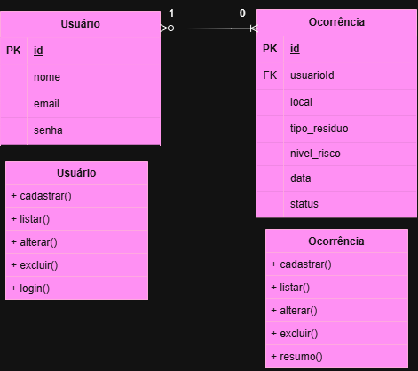

## Tecnologias 
- Node.js
- JavaScript
- Express
- mySQL
- Thunder Client (testes da API)
- Draw.io (criação do diagrama)

## Passo a passo pra testar
1. Abra o terminal e a pasta do projeto
2. Instale as dependências:
```npm install```
3. Certifique-se de que o MySQL esteja em execução e que o banco gestao_residuos tenha sido criado utilizando o script db/script.sql.
4. Confira as configurações de conexão com o banco no arquivo src/db.js.
5. Inicie o servidor Node.js:
```node server.js```
Caso o arquivo server.js esteja dentro da pasta src, utilize node src/server.js.
6.Acesse http://localhost:3000 para verificar se o servidor está funcionando.
7.Abrir o Thunder Client e realizar as requisições para testar as rotas da API.

## Print dos Testes

Cadastro de Usuário:
<br>
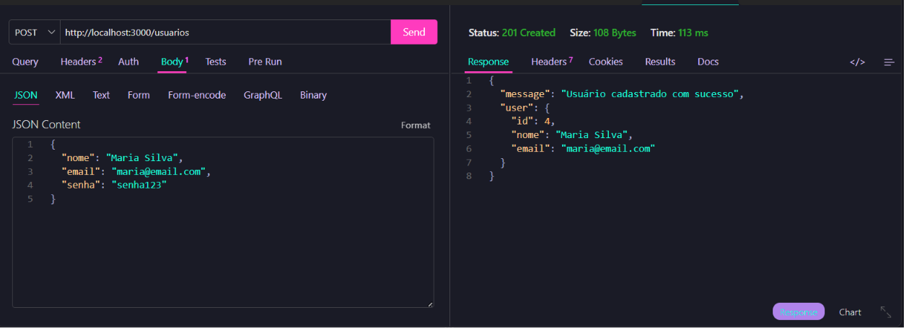

Listagem de usuários:
<br>
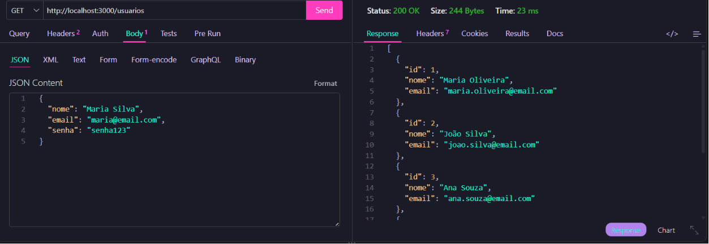

Atualização de usuários:
<br>
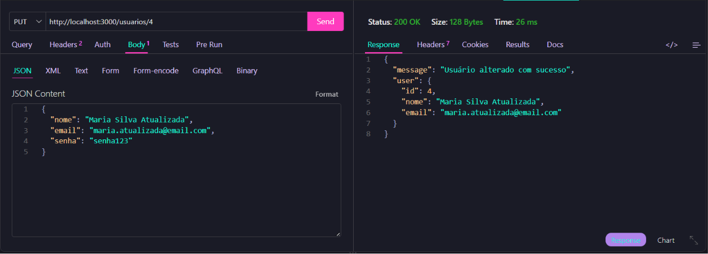

Login:
<br>
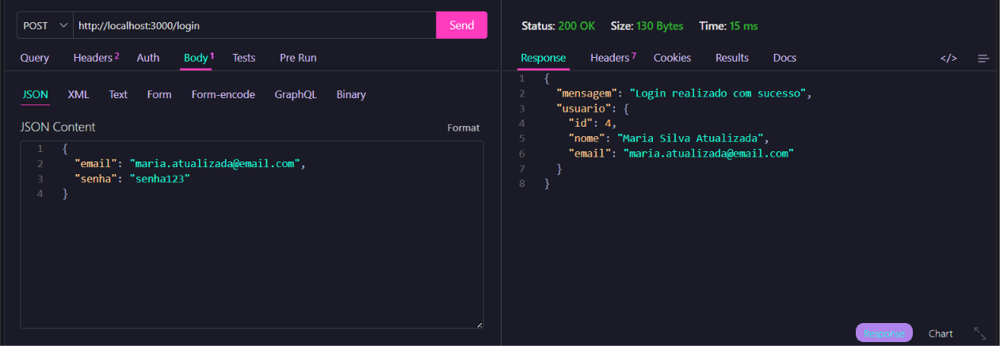

Cadastro de ocorrência:
<br>
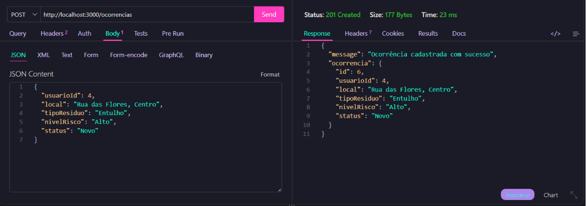

Listagem de ocorrênciass:
<br>
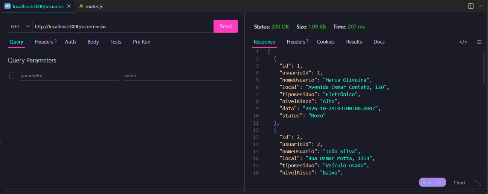

Atualização de ocorrência:
<br>
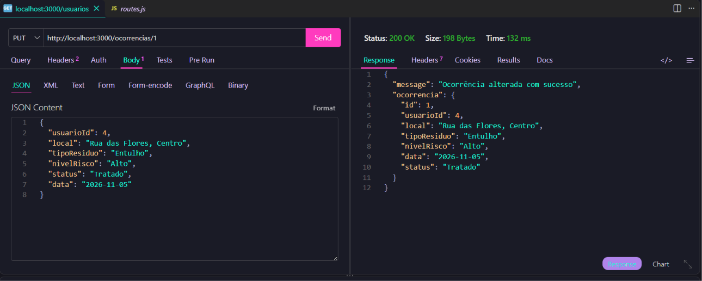

Exclusão de ocorrência:
<br>
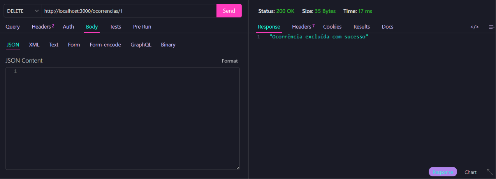

Exclusão de usuário:
<br>
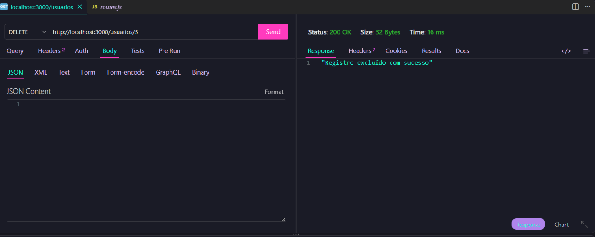

Resumo da quantidade de resíduos tratados:
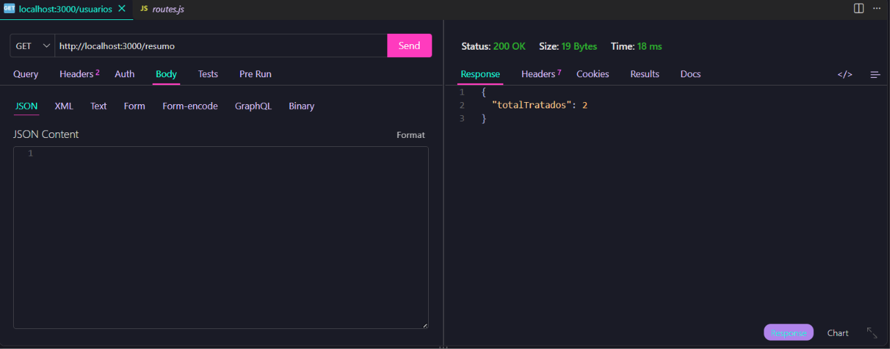